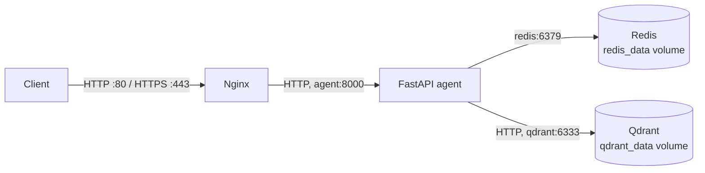

# Docker lab report

## Basic image

`02-docker/develop/Dockerfile` starts with `python:3.11`, the full Python 3.11 base image. `WORKDIR /app` makes `/app` the working directory for subsequent instructions and the default directory at runtime.

The Dockerfile copies `requirements.txt` and installs dependencies before copying application source. Docker can reuse the dependency layer while requirements stay unchanged, so ordinary source edits do not trigger another dependency install.

The file uses `CMD ["python", "app.py"]` to set the default process. `ENTRYPOINT` instead sets the executable that remains fixed; arguments supplied to `docker run IMAGE ...` replace `CMD` arguments, while with an exec-form `ENTRYPOINT` they are passed to the entrypoint. This Dockerfile has no `ENTRYPOINT`.

## Build, run, API and image size

Not completed in this environment. Docker CLI and Compose are installed, but `docker info` cannot connect to `npipe:////./pipe/docker_engine` (Docker daemon unavailable). Therefore the images could not be built, the container/API could not be exercised, and image sizes cannot be measured honestly here.

Once Docker Desktop/Engine is running, from the repository root:

```powershell
docker build -f 02-docker/develop/Dockerfile -t my-agent:develop 02-docker/develop
docker run --rm -d --name agent-develop -p 8000:8000 my-agent:develop
Invoke-RestMethod http://localhost:8000/health
Invoke-RestMethod http://localhost:8000/ask -Method Post -ContentType 'application/json' -Body '{"question":"What is Docker?"}'
docker image ls my-agent:develop
docker rm -f agent-develop
```

## Production multi-stage image

`02-docker/production/Dockerfile` has a `builder` stage based on `python:3.11-slim`, installs build libraries and Python dependencies, then a `runtime` stage based on a fresh `python:3.11-slim`. Runtime copies only the installed user packages and app files, runs as a non-root user, and adds a health check. Build tools and the builder filesystem are excluded from the final image, which is why this design should be smaller than the basic full-Python single-stage image. Actual sizes are pending a successful build.

Build and compare from the repository root:

```powershell
docker build -f 02-docker/production/Dockerfile -t my-agent:production .
docker image ls my-agent:develop my-agent:production
```

| Image | Measured size |
|---|---|
| `my-agent:develop` | Pending: Docker daemon unavailable |
| `my-agent:production` | Pending: Docker daemon unavailable |

## Compose architecture

`docker compose config` could not fully validate/start the stack because the ignored `02-docker/production/.env.local` file is absent. The stack defines four services. The app and data services share the `internal` bridge network; Compose DNS resolves service names such as `agent`, `redis`, and `qdrant`. Only Nginx publishes host ports. Redis and Qdrant data are persisted in named volumes.



The Compose file has a single `agent` service definition and Nginx upstream currently lists only `agent:8000`; comments describe adding instances later. It does not currently configure two agent replicas or load balance across multiple instances. Compose also reports that the top-level `version` key is obsolete and ignored by the installed Compose version.

After Docker Engine is available and a local `.env.local` has been supplied, run `docker compose -f 02-docker/production/docker-compose.yml up --build -d`, inspect with `docker compose -f 02-docker/production/docker-compose.yml ps`, then check `http://localhost/health` and `http://localhost/ask`. The lab Compose file maps HTTP to port 80 (not the `:8080` mentioned in another observability section).
